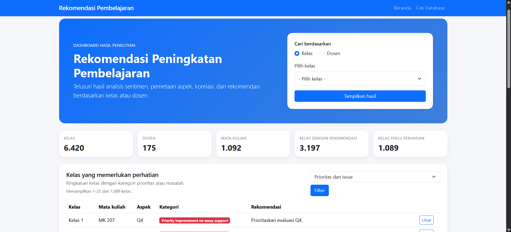
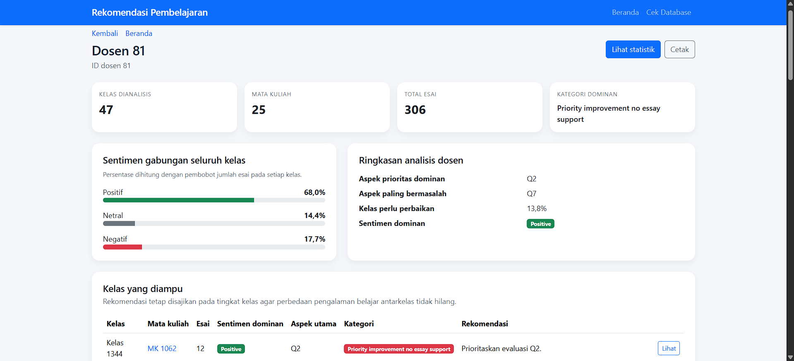
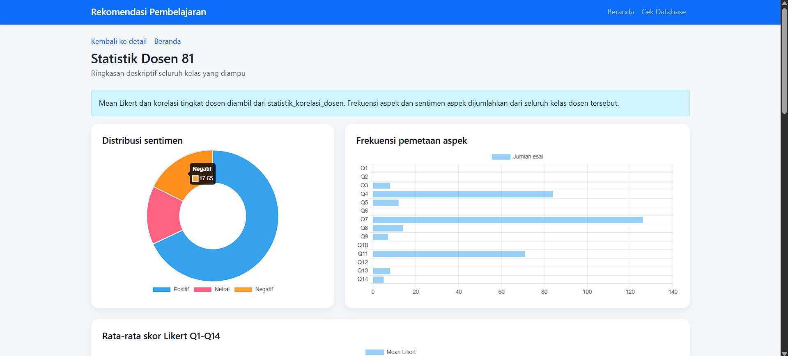

# Dashboard Rekomendasi Pembelajaran

Aplikasi dashboard berbasis PHP native untuk menampilkan hasil analisis
evaluasi pembelajaran per kelas, dosen, dan mata kuliah. Dibuat sebagai
output dari undergradate thesis.

## Preview

### Beranda
Pencarian berdasarkan kelas atau dosen, ringkasan statistik, dan daftar kelas yang memerlukan perhatian.

### Detail Dosen
Sentimen gabungan seluruh kelas, ringkasan analisis, dan rekomendasi per kelas.

### Statistik Dosen
Distribusi sentimen, frekuensi pemetaan aspek, dan rata-rata skor Likert Q1-Q14.

## Fitur

- Pencarian kelas dan dosen
- Ringkasan dashboard
- Sentimen dan rekomendasi per kelas
- Perbandingan antar dosen pada mata kuliah yang sama
- Grafik statistik korelasi dan priority matrix

## Tech Stack

- PHP 8.2 (native)
- MariaDB 10.4
- Docker dan Docker Compose

